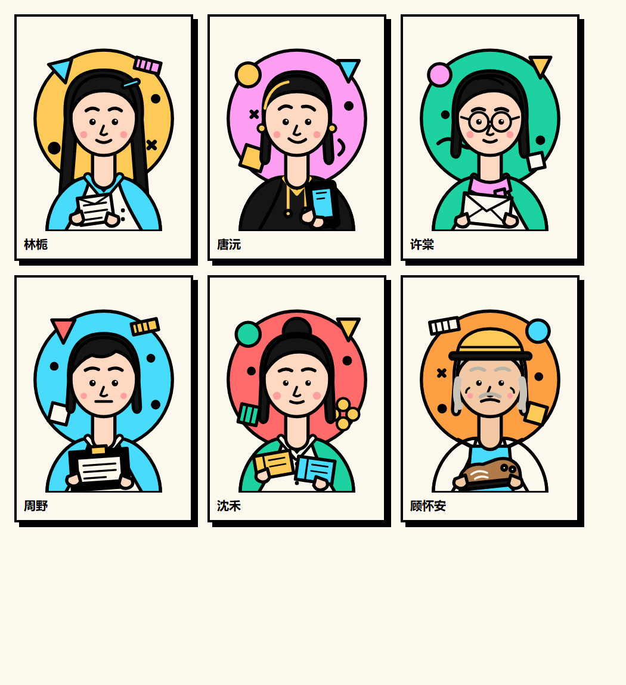

# 情绪药店 · Emotion Pharmacy

一间不出售感冒药的药店。六位客人，十次来访，十封信。

纯前端叙事游戏，无构建步骤、无后端、无外部字体。画面使用 **Memphis 孟菲斯风格**：撞色、粗黑边、硬投影、几何装饰和图案。点击对话逐句推进；可以随时去配药，也可以随时回柜台继续聊天。



## 仓库内容

| 路径 | 内容 |
|---|---|
| `emotion-pharmacy/` | 游戏本体与完整说明 |
| `emotion-pharmacy/README.md` | 玩法、数据结构、风格与测试说明 |
| `EmotionPharmacy-v2.apk` | 安卓 APK（v2.0，Android 7.0+） |
| `emotion-pharmacy/android/` | Android WebView 外壳与无 Gradle 打包脚本 |
| `剧本.md` | 十次来访与十封信的完整剧本 |
| `策划.md` | 玩法、数据结构与交互设计 |
| `风格.md` | Memphis 视觉风格规范 |

## 玩

**浏览器**

双击 `emotion-pharmacy/index.html` 即可。数据用普通 `<script>` 加载，因此 `file://` 下也能运行。

也可以起一个本地服务器：

```bash
node emotion-pharmacy/tools/serve.js
# http://localhost:5173/
```

**安卓**

下载 [EmotionPharmacy-v2.apk](EmotionPharmacy-v2.apk)，传到手机安装；需要允许“安装未知来源应用”。包名 `com.emotionpharmacy.game`，版本 `2.0`，最低 Android 7.0。

APK 使用系统 WebView 加载本地游戏；签名、构建和更新说明见 [emotion-pharmacy/android/README.md](emotion-pharmacy/android/README.md)。

## 游戏内容

- 六位顾客、十次来访、十封信，台词来自 `剧本.md`。
- 一次点击只出现一句；切换界面或刷新后停在原句。
- 问题气泡围绕人物分布，敏感问题的位置随来访轮换。
- 交谈与配药随时切换；只有把药交给客人才会结束这次来访。
- 六种药对六位客人有完全独立的回应，没有评分或“正确答案”。
- 信件延迟送达；可以暂时忘记或铭记于心，部分来信会互相呼应。
- 进度保存在浏览器 `localStorage`；APK 内进度独立保存。


## 风格

奶油纸底 `#fef9ef`，红 / 黄 / 青 / 粉 / 绿撞色，顾怀安与「边界」使用橙色作为第六个强调色。卡片和按钮 4px 黑边、零圆角、硬投影；点阵、斜纹、波浪和棋盘图案；悬停时几何装饰独立移动；动效 150ms ease-out，并支持 `prefers-reduced-motion`。

## 开发

```bash
node emotion-pharmacy/tools/validate.js
node emotion-pharmacy/tools/simulate.js
```

浏览器自检 `e2e.js` / `e2e-reaction.js` 需要带调试端口的 Edge，详见游戏 README。

安卓 APK 重新打包：

```powershell
powershell -NoProfile -ExecutionPolicy Bypass -File emotion-pharmacy/android/build-apk.ps1
```

需要 Android SDK、JDK 17+、Python 3 + Pillow。签名私钥只保留在本地，不随仓库上传。
