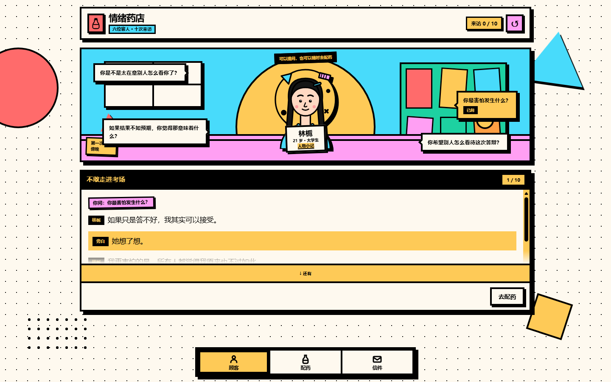

# 情绪药店 · Emotion Pharmacy

一间不出售感冒药的药店。六位客人，十次来访；每一次来信，都按当时配出的那味药写成六种不同的样子。

纯前端叙事游戏，无构建步骤、无后端、无外部字体。画面使用 **Memphis 孟菲斯风格**：撞色、粗黑边、硬投影、几何装饰和图案。


六张立绘源文件在 `assets/characters/`，替换方法见 [assets/characters/README.md](assets/characters/README.md)。

---

## 开始

**方式一：直接打开**

双击 `index.html`。数据用普通 `<script>` 加载，因此 `file://` 下也能运行，不需要本地服务器。

**方式二：本地服务器（可选）**

```bash
node tools/serve.js
# 情绪药店：http://localhost:5173/
```

需要较新的 Chrome / Edge / Safari / Firefox。进度保存在浏览器 `localStorage`，键名 `emotion_pharmacy.save.v1`。顶部右侧的 ↺ 可以重新开始并清空进度。

**方式三：安卓 APK**

已打包为：[EmotionPharmacy-v2.apk](EmotionPharmacy-v2.apk)（约 176 KB，Android 7.0+，侧载安装）。

- 包名 `com.emotionpharmacy.game`，版本 `2.0`，自签名 release APK。
- 安装时允许“安装未知来源应用”即可；没有广告或外部接口。
- APK 是独立安装，浏览器里的存档不会自动迁移过来；APK 内进度会一直保存在应用数据里。
- 构建方式、签名 key 和更新流程见 [android/README.md](android/README.md)。

APK 使用 WebView 加载本地游戏资源，并保留 `localStorage` 存档；它不会真的访问网络。

---

## 玩法

底部固定三个入口：**顾客 / 配药 / 信件**。



### 一次点击，只出现一句

顾客的进店剧情、问题回应、道歉后的回应、交药后的回应、离店旁白，全部按句推进。进入时只出现第一句，之后：

- 点击对话文本区域；
- 或点击「继续 ▸」；
- 或按回车 / 空格（对话区域获得焦点时）。

读到这一段最后一句时，提问气泡或下一步按钮才会出现。切换界面或刷新后，会停在原来的句子，不会重播已经读过的部分。

### 随时去配药，随时回来聊天

交谈和配药是并行的两条线：

- 任何一句对话、任何一个提问之后，都可以点「去配药」或底部「配药」；
- 在药柜里可以先选一味药，选完不交药，随时回柜台继续聊；
- 回柜台后，问题气泡、已问标记和当前对话句子都还在；
- **只有点「把药交给客人」才会结束这次来访**。交药后进入客人的专属回应，再送客。

配药界面会明确写出「交药之后，这次来访就会结束」。

### 提问与反应

问题气泡围绕顾客出现。每位顾客有四个问题，其中一个是容易冒犯的敏感问题。

- 气泡在页面上的位置会随来访编号轮换，敏感问题不会永远在右下角。
- 冒犯性的问题不会用颜色提前标注。
- 触发「生气」后，暂时不能再提问，可以道歉，也可以直接去配药；道歉后会重新开放提问。
- 触发「沉默」后，提问关闭，只能去配药。
- 「防御」类反应不会关闭提问，但会让人物表明自己的立场。

### 信件与记忆

客人离开后信不会立刻出现：下一位客人推门时，上一封信才送达档案。最后一封信在全部来访结束后出现。

每封信都跟着那次来访里你配出的药走：六味药对应六篇不同的标题、正文和结尾。同一次来访，配「停歇」和配「勇气」读到的并不是同一篇；档案里的「第 N 封」编号不变，打开时看到的是当时那一篇。信末仍会附上当时那句话的回响。

每封信读完可以选择「暂时忘记」或「铭记于心」：

- 暂存不会删除信件，之后可以在档案里重新打开；
- 重新选择「现在，我想记住它」时，会更新这封信的记忆状态；
- 林栀第二次来信在特定条件下会出现 Callback；十次来访后把第一封信重新铭记，会出现一次结尾短句。

游戏不显示好感度、信任值或评分。它只记录你做过的事。

### 六种药与六位客人

| 药物 | 主题 |
|---|---|
| 勇气 | 面对恐惧 |
| 相信 | 自我怀疑 |
| 停歇 | 疲惫与压力 |
| 告别 | 失去与结束 |
| 言说 | 表达与沟通 |
| 边界 | 责任与关系 |

| 角色 | 来访次数 | 主题 |
|---|--:|---|
| 林栀 | 3 | 考场、选择、停下来 |
| 唐沅 | 1 | 被看见与数据 |
| 许棠 | 2 | 旧友、未寄出的信 |
| 周野 | 2 | 责任与边界 |
| 沈禾 | 1 | 家庭与自己的生日 |
| 顾怀安 | 1 | 旧招牌与告别 |

同一味药在不同客人身上有完全独立的回应，没有“正确答案”。

---

## 孟菲斯风格

风格参考：`风格.md`（Memphis）。

- 背景：`#fef9ef` 奶油纸色 + 点阵图案；页面边缘有圆、三角、方块、波浪等几何装饰。
- 主色：红 `#ff6b6b`、黄 `#feca57`、青 `#48dbfb`、粉 `#ff9ff3`、绿 `#1dd1a1`；顾怀安使用橙 `#ff9f43`。
- 所有卡片和按钮使用 **4px 黑色粗边**、**零圆角**、**无模糊的硬投影**；小贴纸使用 3px 粗边。
- 卡片内有几何装饰，鼠标悬停时不同图形向不同方向移动或旋转；卡片标题会切换高饱和色。
- 按钮悬停：换色 + 阴影变大；按下：整体位移，阴影消失（玩具按键感）。
- 点状、斜纹、波浪、棋盘图案只用于装饰；正文保持黑字奶油底，保证阅读对比度。
- 不使用平滑渐变、玻璃态、模糊阴影、细边框和低透明度文字。
- 所有动效 150ms ease-out；`prefers-reduced-motion` 下关闭动画与过渡。

风格规则也意味着界面是“热闹的纸片拼贴”，不是柔软的文学纸张；信件仍然保留了纸的品质，但边缘和印章是硬边的。

---

## 目录结构

```text
emotion-pharmacy/
├── index.html                 入口与脚本顺序
├── EmotionPharmacy-v2.apk     安卓安装包
├── android/                   安卓外壳与打包脚本（见 android/README.md）
├── css/
│   ├── main.css               基础、顶栏、导航、按钮、浮层、通用几何
│   ├── customer.css           舞台、立绘、气泡、逐句对话面板
│   ├── medicine.css           药瓶、药柜、交药回应
│   └── archive.css            信件档案、信纸阅读、结尾
├── js/
│   ├── registry.js            数据注册表与取用接口（不碰界面）
│   ├── storage.js             localStorage 读写
│   ├── state.js               流程、对话进度、存档、记忆状态（不碰 DOM）
│   ├── ui.js                  转义、浮层、确认框、提示条、焦点管理
│   ├── portrait.js            立绘加载与缺图兜底
│   ├── dialogue.js            台词渲染、逐句揭示、滚动提示
│   ├── customer.js            顾客界面
│   ├── medicine.js            配药界面
│   ├── archive.js             信件档案与阅读
│   ├── ending.js              十次来访后的结尾
│   ├── router.js              三个界面的切换
│   └── app.js                 启动、收尾、开发预览
├── data/
│   ├── characters.js          6 位角色资料 + 立绘路径
│   ├── medicines.js           6 种药物定义
│   ├── queue.js               十次来访顺序
│   ├── events/event-001.js … event-010.js
│   └── letters/letter-001.js … letter-010.js
├── assets/
│   └── characters/            六张可替换立绘 + 替换说明
├── docs/
│   ├── characters.png         六位角色立绘总览
│   └── gameplay.png           游戏界面截图
├── tools/
│   ├── validate.js            结构与剧本台词覆盖校验
│   ├── simulate.js            不开浏览器跑完十次来访与存档
│   ├── e2e.js                 真实页面点击自检
│   ├── e2e-reaction.js        敏感提问、道歉、结尾、重新铭记
│   ├── shoot.js               开发用截图（CDP）
│   ├── inspect.js             开发用页面状态检查（CDP）
│   └── serve.js               可选静态服务器
└── README.md
```

---

## 数据格式

数据与程序分离。每个角色、事件、信件都是独立文件，只负责注册内容。

### 角色

```js
{
  id: 'char_linzhi',
  name: '林栀',
  age: 21,
  occupation: '大学生',
  themeColor: '#feca57',
  secondaryColor: '#48dbfb',
  paperColor: '#fef9ef',
  pattern: 'dots',            // dots | zigzag | waves | grid | checker | stripes
  seal: '栀',
  portrait: 'assets/characters/linzhi.svg',
  keywords: ['自我要求', '周全', '迟疑'],
  description: '……',
  speech: ['……'],
  eventIds: ['event_001', 'event_004', 'event_010']
}
```

立绘替换见 [assets/characters/README.md](assets/characters/README.md)。

### 事件

```js
EP.defineEvents([{
  id: 'event_001',
  characterId: 'char_linzhi',
  order: 1,
  title: '不敢走进考场',
  visitLabel: '第一次来访',
  scene: { time: '傍晚' },
  opening: [
    ['n', '傍晚，店门上的铃铛响了一声。'],
    ['c', '你好，请问……这里真的有那种药吗？'],
    ['o', '哪一种？']
  ],
  talkPrompt: '她把那张纸放在膝盖上，指尖压着一角，等着你开口。',
  handover: [['n', '她接过瓶子，指尖在标签上停了一下。']],
  questions: [{
    id: 'q_fear',
    kind: 'deep',
    text: '你最害怕发生什么？',
    reaction: 'normal',
    beats: [['c', '如果只是答不好，我其实可以接受。']]
  }, {
    id: 'q_sharp',
    kind: 'sharp',
    text: '你是不是太在意别人怎么看你了？',
    reaction: 'anger',
    lockNote: '她不再看向你，把那张纸慢慢折了起来。',
    beats: [['c', '你只听了我几句话，就觉得问题在这里吗？']],
    recovery: [['c', '……没关系。']]
  }],
  medicineResponses: {
    courage: { beats: [['c', '我想，我可以害怕着走进去。']] }
  },
  departure: [['n', '门上的铃铛轻轻响了一声。']],
  letterId: 'letter_001'
}]);
```

台词缩写：

- `n`：旁白
- `c`：顾客
- `o`：你（店主）

一条 beat 也可以写成 `{ type: 'customer', text: '…' }`。

反应类型：`normal`、`uneasy`、`evade`、`anger`、`silence`、`defensive`。`anger` 会锁住提问并提供道歉；`silence` 会锁住提问且不能道歉；`defensive` 不锁。具体台词始终由数据提供。

### 对话进度

每次来访的内部状态记录在存档里，而不是写进事件数据：

```js
{
  phase: 'opening' | 'talk' | 'handover' | 'departure',
  asked: ['q_fear'],
  reactionQuestion: 'q_sharp',
  locked: false,
  apologised: true,
  medicine: 'believe',
  draft: 'believe',           // 已选但还没交的药
  view: { kind: 'question', questionId: 'q_fear', shown: 2 }
}
```

`shown` 是当前段落已经显示到第几句；切换界面和刷新都依赖它。`draft` 让“先选药、再回柜台”不会丢选择。只有 `giveMedicine` 会把 `phase` 推进到 `handover`。

### 信件

```js
{
  id: 'letter_001',
  characterId: 'char_linzhi',
  eventId: 'event_001',
  number: 1,
  salutation: '药店老板：',
  signature: '林栀',
  variants: {
    courage: {
      title: '走进去了',
      lines: ['答辩结束了。', '', '只是这一次，我没有等到不怕了才走进去。'],
      echoPrefix: '那天你没有接话。她说完就低头去看标签——'
    },
    rest: {
      title: '一碗面',
      lines: ['答辩结束了。', '', '我想先把这一天还给自己。'],
      echoPrefix: '信封里掉出一张面馆的小票，背面什么都没有写。你记得她那天走得很慢——'
    }
    // 六味药各一篇：courage / believe / rest / farewell / speak / boundary
  }
}
```

`variants` 的键是药物 ID。玩家在某次来访里配了哪味药，档案里打开的就是那一篇；同一封信的标题也会跟着变（「第 N 封」的编号不变）。某一味药没有写时，退回 `variants` 里的第一篇，不会出现空信；顶层的 `title` / `lines` / `echoPrefix` 只作兜底。

`lines` 里的空字符串表示段落间距。`echoPrefix` 之后自动接上这次来访中“所选药物的第一句顾客台词”，作为信末的药物回响。六篇写法要各配一句不同的引导语，别让所有结尾都落在同一个句式上。

`callback`（可选）用于跨信呼应，目前只有 `letter_004` 使用：

```js
callback: {
  dependsOn: 'letter_001',
  memoryState: 'remembered',
  text: '你记得她第一次来时，手里拿着一张折过很多次的纸。',
  linkLetterId: 'letter_001',
  linkLabel: '重新读一遍第一封来信'
}
```

> 数据文件是 `.js` 而不是 `.json`，因为它们通过 `EP.defineXxx` 注册，这样双击 `index.html` 也能加载。对象结构与策划书中的 JSON 示例一致；如果改回 JSON，需要用本地服务器或打包工具解决 `fetch` 的跨域限制。

---

## 新增一位顾客（不改核心代码）

1. 在 `data/characters.js` 里加角色资料，并准备一张立绘放进 `assets/characters/`。
2. 在 `data/events/` 新增事件文件，写好进店剧情、至少三个问题（含一个敏感问题）、六种药物回应、离店旁白。
3. 在 `data/letters/` 新增对应信件。
4. 把事件 ID 加入 `data/queue.js`。
5. 在 `index.html` 里按顺序加上脚本标签。
6. 运行 `node tools/validate.js`，按提示补齐遗漏。

不需要修改顾客、配药、信件三个界面，也不需要改核心引擎。

---

## 校验与测试

```bash
node tools/validate.js   # ID、引用、药物覆盖、信件、立绘路径、剧本台词覆盖
node tools/simulate.js   # 十次来访、逐句推进、自由切换、信件、刷新恢复
```

`validate.js` 会把 `剧本.md` 中每个事件段落里以「」包住的台词与数据比对，防止转写漏句；目前十次来访全部 100%。

需要浏览器的自检：

```bash
# 先启动带调试端口的无头 Edge
msedge --headless=new --remote-debugging-port=9333 --user-data-dir=%TEMP%\ep-cdp about:blank

node tools/e2e.js            # 逐句对话、切配药、回柜台、信件、存档
node tools/e2e-reaction.js   # 敏感问题、道歉、结尾、重新铭记
```

`e2e.js` 会验证：开场只出现一句、点击后出现第二句、气泡位置不固定、中途去配药再回来仍可继续聊、读完回应才能送客、信件解锁与刷新恢复。

---

## 开发预览

带 `?preview=` 参数打开时不会写入存档：

```text
?preview=idle            空店
?preview=opening         客人刚进店（只显示第一句）
?preview=talk            提问与已完成的回应
?preview=reaction        敏感提问后的反应
?preview=dispense        配药（已选中「相信」）
?preview=given           交药后的回应
?preview=departure       离店旁白
?preview=archive         信件档案（含已送达与未送达）
?preview=letter          打开第四封信（含 Callback）
?preview=letter-deferred 打开暂存状态的第一封信
?preview=closing         结尾状态下重新铭记第一封信
?preview=ending          结尾
?preview=profile         人物小记
```

---

## 状态与流程

```text
beginNext
  → opening（逐句）
  → 最后一句：phase = talk
  → 提问 / 回应 / 道歉（随时可切 medicine，不改变 phase）
  → giveMedicine：phase = handover（逐句回应）
  → 回应读完：送客 → phase = departure（逐句旁白）
  → 旁白读完：今日到此为止 → complete
```

- 配药界面在 `opening` 和 `talk` 都可以打开；`handover` / `departure` 时只会展示已经交出的药和回应。
- `toDeparture` 和 `complete` 都会检查当前段落是否读完，避免跳过文字。
- 对话进度、预选药、记忆状态全部按 ID 存入 `localStorage`。

---

## 实现说明与取舍

- **台词来自剧本**：`剧本.md` 中十次来访的进店剧情、全部提问与回应、药物回应均已完整转写，台词覆盖 100%。信件以剧本里的十封信为底本，按六味药改写成六十篇（标题、正文与结尾各不相同），因此信件正文不再逐句对应剧本，也不参与覆盖检查。
- **少量补充文本**：为交互完整性新增了「道歉后的回应」「交付与离店的旁白」「空店文案」「人物小记」「药柜手记」。这些文字尽量贴近角色原本的语言习惯，均可直接在对应数据文件中替换。
- **没有数值系统**：不设好感度、信任值、心理健康值；记忆状态只表示玩家如何对待一封信。
- **立绘是可替换资源**：六张 SVG 放在 `assets/characters/`，换图只需改 `data/characters.js` 的 `portrait`；缺图时有占位图。详见 [assets/characters/README.md](assets/characters/README.md)。
- **风格**：Memphis；所有卡片使用 4px 黑边、硬投影、几何装饰和 150ms ease-out 动效，支持 `prefers-reduced-motion`。
- **无音频**。移动端适配到 390px 宽，底部导航固定并留出安全区。

已知边界：剧本中「生气/沉默后仍愿意配药」的设定被保留，因此没有实现「顾客不拿药直接离店」的分支；第一版只有一个固定事件顺序和一档本地存档。
